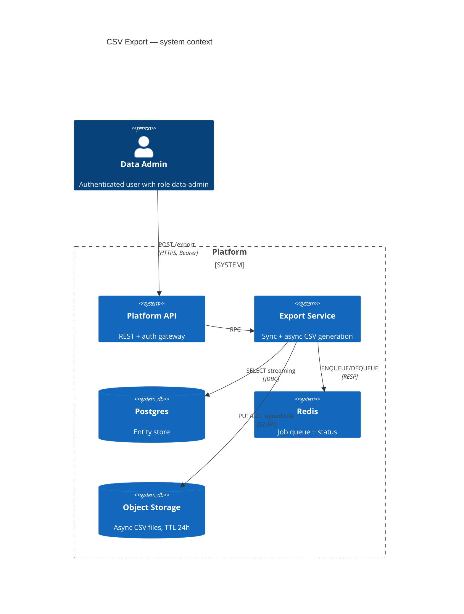
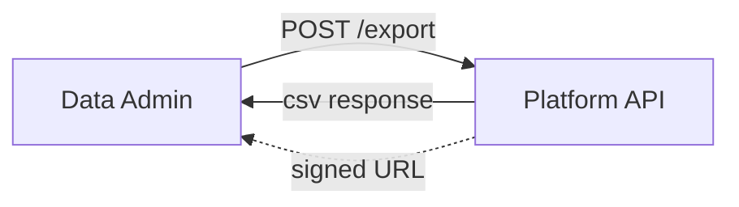
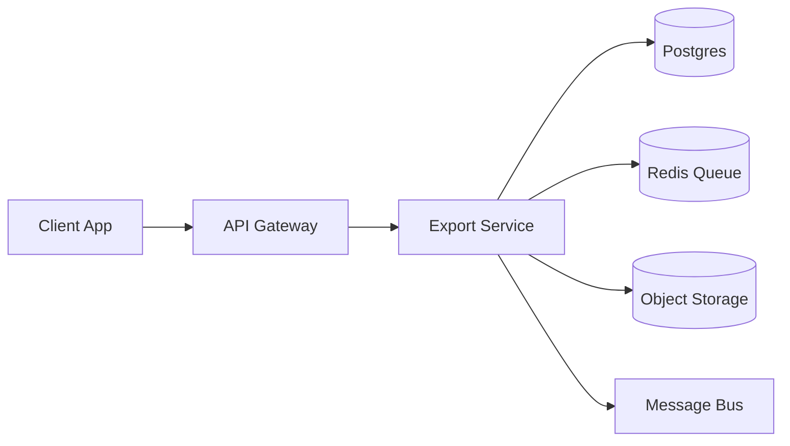
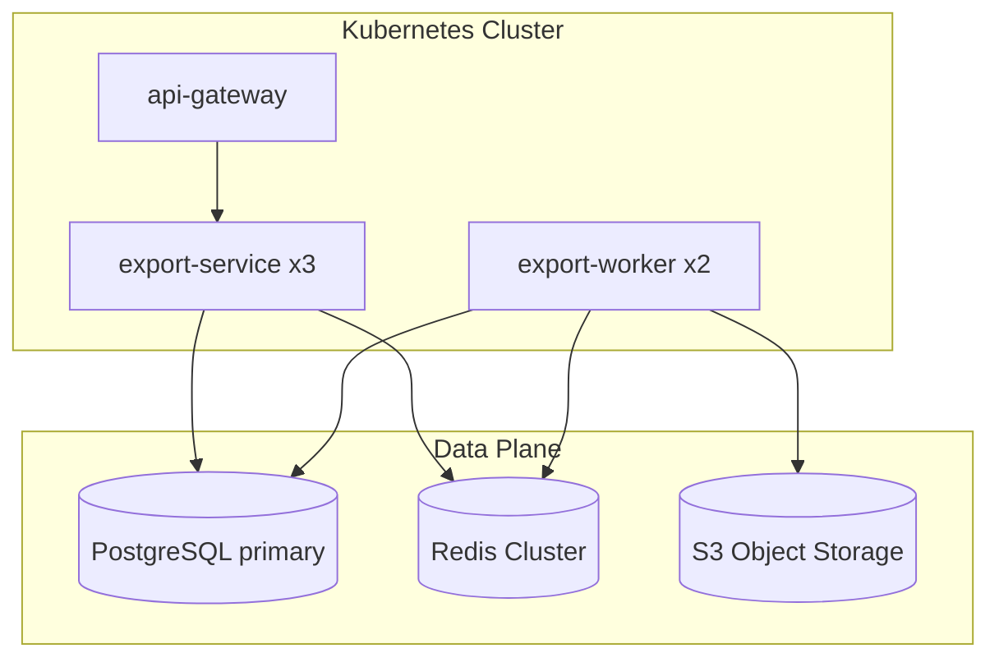

# Design: INIT-2026-099-csv-export

> arc42-lite. Source of truth по требованиям — [`requirements.yml`](./requirements.yml).
> Profile: Standard.

---

## 1. Цели и ограничения

**Goals (MUST):**

- Один HTTP-эндпойнт для экспорта всех типов entity (contact, deal, event, activity).
- Sync для типичных объёмов (≤ 100k), async для больших (REQ-EXPORT-001, REQ-EXPORT-002).
- P95 < 5s для sync (REQ-EXPORT-004).
- Hardcoded blocklist для sensitive fields (REQ-EXPORT-005).

**Constraints (MUST):**

- Backwards-compatible с существующим Bearer-auth — никаких новых auth-механизмов.
- UTF-8 без BOM по умолчанию (BOM по `?bom=true` для Excel).
- Streaming write — не загружаем датасет целиком в память.

---

## 2. Контекст и границы (C4 Context)

Trust boundaries: внешний клиент пересекает публичную границу через API Gateway (auth, rate-limit).
Внутри — service mesh, mTLS.

---

## 3. Архитектурная стратегия

**Подход:** dual-mode export.

- **Sync path** (≤ 100k rows): API gateway → Export Service → Postgres `COPY ... TO STDOUT`
  стримом → конкатенация в HTTP response. Никакой промежуточной материализации.
- **Async path** (> 100k rows OR `async=true`): Export Service создаёт job в Redis,
  возвращает 202 + job_id. Worker подписан на очередь, стримит из PG в S3,
  по завершении публикует событие `export.job.completed` (см. `contracts/asyncapi.yaml`).

**Выбор обоснован в [INIT-2026-099-ADR-0001-sync-vs-async](./decisions/INIT-2026-099-ADR-0001-sync-vs-async.md).**

---

## 4. Архитектурная классификация (онтология АИС)

| Параметр | Значение |
|---|---|
| Масштаб системы | `С.М.М` (малый: < 10 узлов, < 100k LOC) |
| Тип подсистемы | `ПС.Т.П` (прикладная — обслуживает прикладную задачу пользователя) |
| Вид деятельности | Управление данными / выгрузка |
| Владелец | `@platform-team` |

---

## 5. Архитектурные представления

### Д-1: Внешнее взаимодействие деятельности

### П-1: Внешнее взаимодействие подсистемы

### Т-1: Технологические узлы

---

## 6. Контракты и данные

- REST: [`contracts/openapi.yaml`](./contracts/openapi.yaml) — `POST /export`, `GET /export/jobs/{jobId}`
- Async: [`contracts/asyncapi.yaml`](./contracts/asyncapi.yaml) — `export.job.completed`, `export.job.failed`
- JSON Schema: [`contracts/schemas/export-job.schema.json`](./contracts/schemas/export-job.schema.json)

**Изменения схемы данных:** нет (стейтлес — задания в Redis с TTL 48h, файлы в S3 с TTL 24h).

---

## 7. Качество и NFR

| NFR | Источник | Цель | Verification |
|---|---|---|---|
| Latency (sync) | REQ-EXPORT-004 | P95 < 5s @ 50 rps | `tests/perf/export-latency.k6.js` + Grafana SLO panel |
| Availability | PRR (`ops/prr-checklist.md`) | ≥ 99.5% / 30d | SLO `csv-export-availability` |
| Sensitive data hygiene | REQ-EXPORT-005 | 0 leaks | `tests/api/export-security.spec.ts` + регрессия в CI |

См. также [`ops/slo.yaml`](./ops/slo.yaml).

---

## 8. Развёртывание и миграции

- Rollout: feature flag `platform.csv_export.enabled` — internal → 10% canary → 100%.
  Подробнее в [`delivery/rollout.md`](./delivery/rollout.md).
- Миграции БД: **нет**. Stateless фича.
- Rollback: flip feature flag (RTO < 1 мин).
