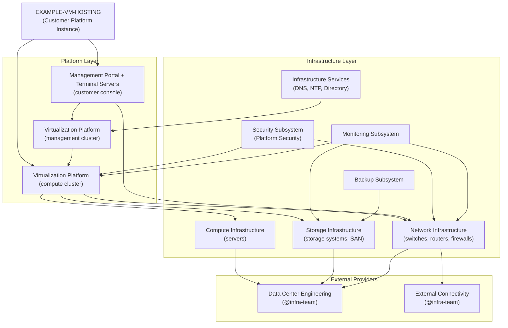
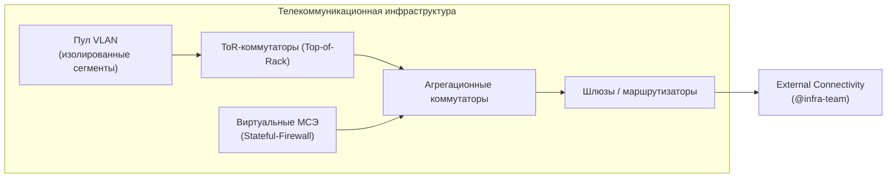
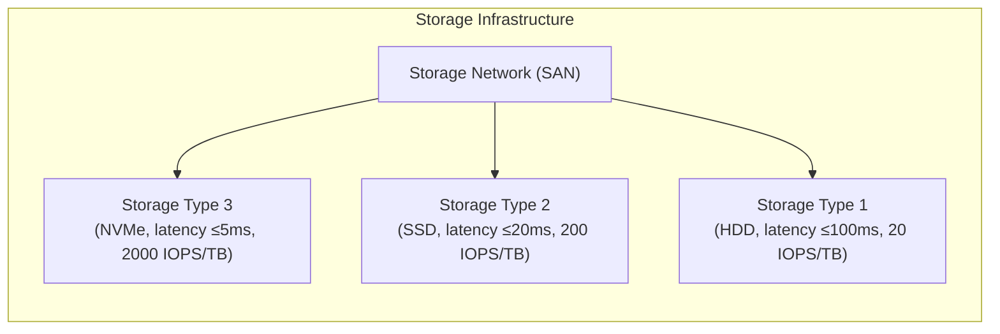
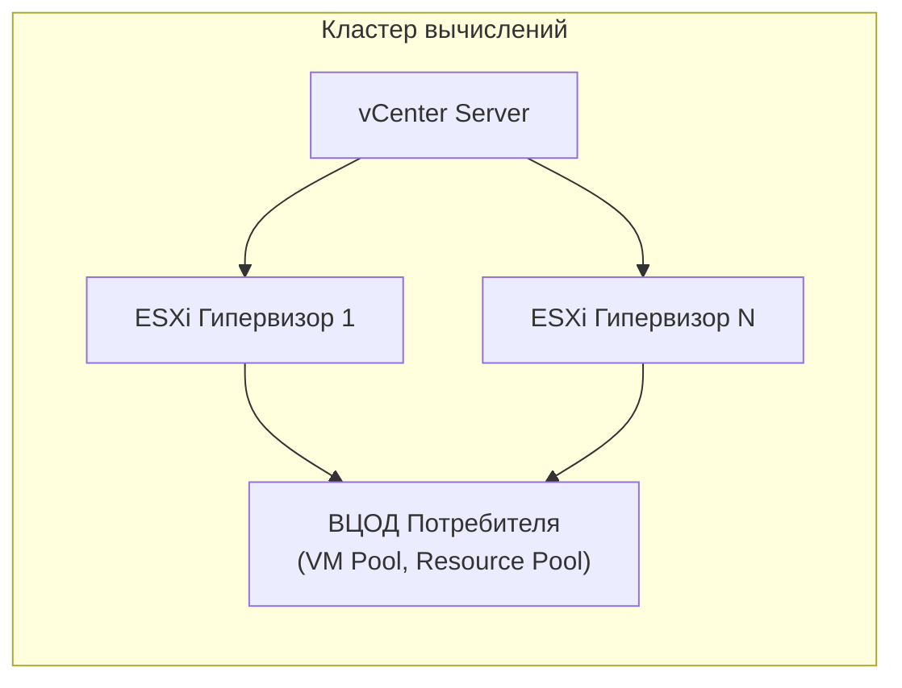
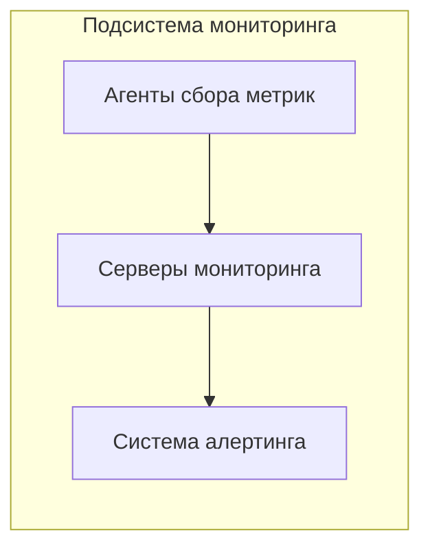

<!-- FILE: services/example-vm-hosting/rsm.md -->
<!-- Resource-Service Model for EXAMPLE-VM-HOSTING.
     Example service specification for OSS framework -->

# Resource-Service Model: EXAMPLE-VM-HOSTING

**Service:** Example Cloud Platform Delivery
**Product:** [`products/platform/`](../../products/platform/)
**Version:** 0.85
**Date:** 2026-03-02

---

## Legend

| Type | Description |
|---|---|
| 🔷 Box | Component/subsystem operated by @platform-team |
| 🔶 Box | Component operated by external provider |
| ➡️ Arrow | Dependency / resource consumption |

---

## Overall RSM Diagram

---

## РСМ — Телекоммуникационная инфраструктура

Обеспечивает сетевую связность внутри ВЦОД, межсетевое экранирование и доступ в Интернет.

| Component | Type | Owner |
|---|---|---|
| Aggregation switches | Physical | @platform-team |
| ToR switches | Physical | @platform-team |
| Virtual firewalls | Virtual | @platform-team |
| Gateways/routers | Physical | @platform-team |
| External connectivity | Service | @infra-team |

---

## Storage Infrastructure

Provides three storage types with different IOPS and latency characteristics.

---

## РСМ — Платформа виртуализации VMware (кластер вычислений)

**Параметры лимитов платформы VMware:**

| Параметр | Мин | Макс |
|---|---|---|
| vCPU для одной ВМ | 1 | 48 |
| vRAM для одной ВМ | 1 Гб | 768 Гб |
| vHDD для одной ВМ | 1 Гб | 15 ТБ |
| Кол-во vHDD для одной ВМ | 1 | 26 |
| vNIC для одной ВМ | 1 | 10 |
| Пропускная способность vNIC | 1 Гбит/с | 10 Гбит/с |
| VLAN | 10 | 400 |
| Пропускная способность МСЭ | 2 Гбит/с | 10 Гбит/с |
| Терминальных серверов | 1 | 6 |
| Сетевых шлюзов | 1 на VLAN | — |

---

## РСМ — Подсистема мониторинга

Хранение исторических данных: **6 месяцев**.
